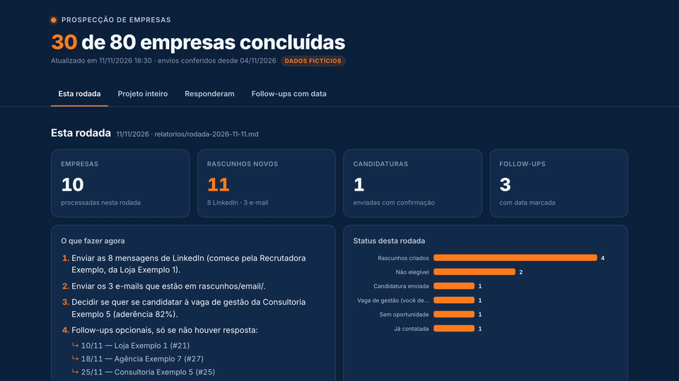

<picture>
  <source media="(prefers-color-scheme: dark)" srcset="assets/header-dark.svg">
  <source media="(prefers-color-scheme: light)" srcset="assets/header-light.svg">
  
</picture>

<h3 align="center">Stop looking for jobs. Start looking for companies.</h3>

<p align="center">
  A Claude Code agent that builds the list of companies using your tech stack, researches them one by one<br>
  and leaves LinkedIn and email drafts ready for <b>you</b> to review and send.
</p>

<p align="center">
  <a href="https://roni-clei-santos.github.io/ai-company-prospector/demo/"><b>Live demo</b></a> ·
  <a href="docs/web/PROMPT-planilha.en.md"><b>No install</b></a> ·
  <a href="#quick-start"><b>Quick start</b></a> ·
  <a href="docs/guia/01-instalacao.md"><b>Guide (PT)</b></a> ·
  <a href="ROADMAP.md"><b>Roadmap</b></a> ·
  <a href="README.md"><b>Português</b></a>
</p>

<p align="center">
  <a href="LICENSE"></a>
  <a href="https://github.com/roni-clei-santos/ai-company-prospector/actions/workflows/test.yml"></a>
  <a href="#quick-start"></a>
  <a href="https://code.claude.com/docs/en/overview"></a>
</p>

<p align="center"><a href="https://roni-clei-santos.github.io/ai-company-prospector/demo/"></a></p>

<p align="center"><sub>Demo dashboard with 100% fictitious data (in Portuguese). <a href="https://roni-clei-santos.github.io/ai-company-prospector/demo/">Open the live demo</a>.</sub></p>

## Which path is yours?

| Your account | What you get | What you need | Start here |
|---|---|---|---|
| Claude Free | A list of real companies with sources, in Excel, and a draft message for each one | Just the browser, nothing to install | [Web mode](docs/web/PROMPT-planilha.en.md) |
| Claude Pro or higher, no LinkedIn | The full spreadsheet through Claude Code, no batch limit | Claude Code + a computer (macOS, Linux or Windows) | [Quick start](#quick-start) |
| Claude Pro or higher + LinkedIn | The full robot: rounds of 10, drafts and dashboard | Claude Code + Chrome with the Claude in Chrome extension + LinkedIn logged in | [Quick start](#quick-start) |

<sub>Sources: [web search on all plans](https://support.claude.com/en/articles/10684626) · [file creation on all plans](https://support.claude.com/en/articles/12111783) · [Claude in Chrome on paid plans](https://support.claude.com/en/articles/12012173) · [plans and pricing](https://claude.com/pricing).</sub>

## Before × After

| Looking for jobs in the dark | Prospecting companies with the agent |
|---|---|
| Waits for the right job to show up on a job board | Starts from the list of companies using your tech stack, each with its source |
| Sends the same résumé everywhere | Every job gets a fit score and, if it passes, a tailored résumé |
| Doesn't know who the recruiter is or the HR email | Finds recruiters, HR and emails, and checks each person's current role |
| Loses track of who replied and who needs a follow-up | Memory across rounds: checks what you sent and dates the follow-ups |
| Forgets agencies and freelance chances | Also opens partnership and white-label talks with agencies in your stack |

## Features

<table>
  <tr>
    <td width="33%" valign="top"><br><b>Company list with sources</b><br><code>/build-company-list</code> builds the spreadsheet from public sources, with evidence and a link for every company.</td>
    <td width="33%" valign="top"><br><b>Rounds of 10, with memory</b><br><code>/next-companies</code> works through 10 companies at a time and resumes exactly where it stopped.</td>
    <td width="33%" valign="top"><br><b>Read-only LinkedIn</b><br>Opens invitations, messages, jobs and company pages. Never sends, likes, follows or withdraws.</td>
  </tr>
  <tr>
    <td width="33%" valign="top"><br><b>Drafts you review</b><br>LinkedIn messages and emails in your tone of voice, saved as drafts for you to read and send.</td>
    <td width="33%" valign="top"><br><b>A dashboard with everything left to do</b><br>The <b>Pendentes</b> (to-do) tab gathers, from every round, the LinkedIn messages (ready text and a copy button), the emails, the overdue follow-ups and your decisions. <code>/painel</code> refreshes the list without spending a round.</td>
    <td width="33%" valign="top"><br><b>Token savings with RTK</b><br>The installer sets up <a href="https://github.com/rtk-ai/rtk">RTK</a>, which trims command output before it reaches Claude.</td>
  </tr>
  <tr>
    <td width="33%" valign="top"><br><b>Web mode, nothing to install</b><br>On Claude's free plan, a text you paste into <a href="docs/web/PROMPT-planilha.en.md">claude.ai</a> returns the Excel spreadsheet, with sources and a draft message per company.</td>
    <td width="33%"></td>
    <td width="33%"></td>
  </tr>
</table>

## How it works

<picture>
  <source media="(prefers-color-scheme: dark)" srcset="assets/flow-dark.en.svg">
  <source media="(prefers-color-scheme: light)" srcset="assets/flow-light.en.svg">
  
</picture>

`perfil.local.md` is the single source of truth about you (dated work history, skills, salary floors, tone of voice). The agent never states anything that is not in it, in your résumé or in your answers.

<picture>
  <source media="(prefers-color-scheme: dark)" srcset="assets/stats-dark.en.svg">
  <source media="(prefers-color-scheme: light)" srcset="assets/stats-light.en.svg">
  
</picture>
<p align="center"><sub>Numbers from the author's real use.</sub></p>

## Three ways to use it

| | **Web mode** | **Spreadsheet only** | **Spreadsheet + robot** |
|---|---|---|---|
| Where it runs | In a claude.ai chat | In Claude Code, in the project folder | In Claude Code + your Chrome |
| How it starts | Pasting the [web mode text](docs/web/PROMPT-planilha.en.md) | `/build-company-list` | `/build-company-list`, then `/next-companies` every round |
| Pace | Up to 25 companies per chat; to continue, attach the spreadsheet in a new chat | One search until the sources run out | Rounds of 10 companies, with memory between them |
| Messages | One draft first message per company, inside the spreadsheet | None: you write them | LinkedIn and email drafts per person, jobs scored and a tailored résumé |
| Who reaches out | You | You | You send the drafts the robot prepared |

All three spreadsheets have the same columns: you can start in web mode and [take the spreadsheet to Claude Code later](docs/guia/00-sem-instalar.md#e-depois) (guide in Portuguese).

## Quick start

<details open>
<summary><b>macOS</b></summary>

```bash
# 1. Claude Code (if you don't have it yet)
curl -fsSL https://claude.ai/install.sh | bash

# 2. Project
git clone https://github.com/roni-clei-santos/ai-company-prospector.git
cd ai-company-prospector
./install.sh
```

`install.sh` uses Homebrew for Python and RTK, installs the skills in `~/.claude/skills` and creates your `perfil.local.md`.
</details>

<details>
<summary><b>Linux</b></summary>

```bash
# 1. Claude Code (if you don't have it yet)
curl -fsSL https://claude.ai/install.sh | bash

# 2. Project
git clone https://github.com/roni-clei-santos/ai-company-prospector.git
cd ai-company-prospector
./install.sh
```

`install.sh` installs `python3` and `pip` with `apt`, `dnf` or `pacman` (it may ask for your `sudo` password), RTK with its official script and the skills in `~/.claude/skills`. Tested on a clean Ubuntu 24.04.
</details>

<details>
<summary><b>Windows</b></summary>

```powershell
# 1. Claude Code (if you don't have it yet)
irm https://claude.ai/install.ps1 | iex

# 2. Project
git clone https://github.com/roni-clei-santos/ai-company-prospector.git
cd ai-company-prospector
powershell -ExecutionPolicy Bypass -File .\install.ps1
```

`install.ps1` checks Python (`py -3` or `python`), installs RTK with `winget` and **copies** the skills to `%USERPROFILE%\.claude\skills`. After every `git pull`, run `py -3 scripts\atualizar_skills.py` to copy the new version.
</details>

Then, on all three systems: fill in `perfil.local.md`, open Claude Code in the folder (`claude`) and run **`/build-company-list`** to get the spreadsheet (no LinkedIn needed). For "Spreadsheet + robot": run `/chrome`, log in to LinkedIn in that Chrome and run **`/next-companies`** every round. Between rounds, **`/painel`** checks what you already sent and refreshes the dashboard's Pendentes tab, without processing any company ([dashboard guide, in Portuguese](docs/guia/06-painel.md)).

## Requirements

What has been validated on each system:

| System | Installer and automated tests | Full flow with Claude Code + LinkedIn |
|---|---|---|
| macOS | ✅ | ✅ validated by the author |
| Linux | ✅ | not yet validated by a user |
| Windows | ✅ | not yet validated by a user |

On Linux or Windows? Run the full flow and [tell us how it went in an issue](https://github.com/roni-clei-santos/ai-company-prospector/issues/new?template=relato-de-sistema.md). It helps the project a lot.

| Path | You need |
|---|---|
| Web mode | A [claude.ai](https://claude.ai) account (Free works) with "Code execution and file creation" on in Settings > Capabilities ([how to](docs/web/PROMPT-planilha.en.md)) |
| Spreadsheet only | [Claude Code](https://code.claude.com/docs/en/setup) logged in and Git, plus what your system needs (table below) |
| Spreadsheet + robot | Everything in "Spreadsheet only", plus Google Chrome with the Claude in Chrome extension ([guide, PT](docs/guia/03-chrome.md)) and a LinkedIn account logged in on that Chrome. A logged-in Gmail is only needed if you choose `modo_email: "gmail_rascunho"`; with `"arquivo"`, emails stay in `rascunhos/email/` |

| System (Claude Code) | You need |
|---|---|
| macOS 13+ | [Homebrew](https://brew.sh) (the installer takes care of Python 3 and RTK) |
| Linux | `sudo` and `apt`, `dnf` or `pacman`, or Python 3.9+ with `pip` already installed |
| Windows 10+ | Python 3.9+ ([python.org](https://www.python.org/downloads/windows/) or `winget install Python.Python.3.12`) |

Full step-by-step guide (Portuguese): [docs/guia](docs/guia/01-instalacao.md). The skills, the agent rules and the guides are in Portuguese for now; an English version is on the [roadmap](ROADMAP.md).

## Principles

<table>
  <tr><td width="48"></td><td><b>AI drafts, you decide.</b> Messages and emails are always drafts, and management jobs never get an automatic application.</td></tr>
  <tr><td></td><td><b>Read-only on LinkedIn.</b> At a human pace. If a rate-limit or verification warning shows up, it stops.</td></tr>
  <tr><td></td><td><b>Memory across rounds.</b> <code>controle/progresso.json</code> keeps each company's status; nothing is redone and no contact is repeated.</td></tr>
  <tr><td></td><td><b>Nothing goes out unreviewed.</b> Email stays in a file or as a Gmail draft. You read, edit and send.</td></tr>
  <tr><td></td><td><b>Never makes things up.</b> Every statement about you comes from your profile, résumé or answers. When in doubt, it asks.</td></tr>
</table>

## FAQ

<details>
<summary><b>Is it safe for my LinkedIn account?</b></summary>

The agent only reads, in your own logged-in Chrome, screens you would see yourself: sent invitations, messages, jobs, pages and profiles. It browses at a human pace and stops using LinkedIn for the round if a rate-limit or verification warning shows up. Still, LinkedIn's terms restrict automation (see the notice below).
</details>

<details>
<summary><b>Can I use it without connecting my LinkedIn?</b></summary>

Yes, in two ways. In [web mode](docs/web/PROMPT-planilha.en.md), with nothing to install. Or in "Spreadsheet only" mode: `/build-company-list` does not need LinkedIn: you get real companies using your tech stack, each with evidence and a source link, and you reach out yourself. A LinkedIn account logged in on Chrome is only required for "Spreadsheet + robot" (`/next-companies`), with rounds of 10, drafts and the dashboard.
</details>

<details>
<summary><b>Does it send messages by itself?</b></summary>

No. LinkedIn messages and emails are always drafts. The only action it may take on its own is applying on a job platform (Gupy, the company's site), and only when the job passes every rule (75% fit or more and no deal-breaker). Management jobs are always left for you to decide.
</details>

<details>
<summary><b>Does it work for a stack other than Magento?</b></summary>

Yes. `/build-company-list` asks for the technology and the country and builds `empresas-<technology>-<country>.xlsx`, and the agent rules are generic. Magento / Adobe Commerce is just the author's use case.
</details>

<details>
<summary><b>Do I need to pay for anything?</b></summary>

The project is free (MIT license). What changes is your Claude plan:

- **Claude Free:** [web mode](docs/web/PROMPT-planilha.en.md) gives you a list of real companies with sources, in Excel, and a draft message for each one. You only need the browser.
- **Claude Pro or higher, no LinkedIn:** the full spreadsheet through Claude Code, no batch limit. You need Claude Code on a computer (macOS, Linux or Windows).
- **Claude Pro or higher + LinkedIn:** the full robot, with rounds of 10, drafts and dashboard. You need Claude Code and Chrome with the Claude in Chrome extension, with LinkedIn logged in.

<sub>Sources: [web search on all plans](https://support.claude.com/en/articles/10684626) · [file creation on all plans](https://support.claude.com/en/articles/12111783) · [Claude in Chrome on paid plans](https://support.claude.com/en/articles/12012173) · [plans and pricing](https://claude.com/pricing).</sub>
</details>

<details>
<summary><b>How much does it cost in tokens?</b></summary>

It runs on your own Claude Code account, and usage depends on your plan and on how many pages each company needs. That is why the work is split into rounds of 10 companies, and RTK trims terminal output before it reaches the model. The project itself costs nothing.
</details>

<details>
<summary><b>Does my data go anywhere?</b></summary>

Your profile, spreadsheets, drafts, reports and résumés stay on your computer (they are in `.gitignore`). The project has no server. What Claude Code reads to do the work goes through Anthropic, as with any Claude Code use, and browsing happens in your own Chrome.
</details>

<details>
<summary><b>Does it work on Windows?</b></summary>

Installer and automated tests: ✅. `install.ps1` runs on PowerShell 5.1 and 7, copies the skills (Windows needs special permission for symbolic links) and is tested on every push with GitHub Actions (`windows-latest`), with the tests and the dashboard. Full flow with Claude Code + LinkedIn: not yet validated by a user. On Windows? Run the full flow and [tell us how it went in an issue](https://github.com/roni-clei-santos/ai-company-prospector/issues/new?template=relato-de-sistema.md). It helps the project a lot.
</details>

## Privacy and data protection (LGPD)

**What the robot stores.** Name, job title, company, profile link and, when available, the work e-mail of recruiters and HR contacts. Under Brazil's LGPD (and laws like the GDPR), this is personal data, even when it comes from a public profile.

**Where it lives.** Only on the user's computer, in the folders and files that `.gitignore` keeps out of git: `controle/`, `rascunhos/`, `relatorios/`, `evidencias/`, `curriculos/`, `perfil.local.md`, the `.xlsx` spreadsheets, the `relatorio-*.md` files and `painel/data.json`. Nothing goes to a project server, because the project has no server.

**Who is responsible.** Whoever uses the robot becomes responsible for this data.

**Good practices.**
- Use the data only for professional contact.
- Do not share or publish the data folders.
- Delete what you no longer need. In the project folder:
  - macOS and Linux: `rm -rf controle rascunhos relatorios evidencias`
  - Windows (PowerShell): `Remove-Item -Recurse -Force controle, rascunhos, relatorios, evidencias`
- Honor anyone who asks not to be contacted: record the person as `NAO_CONTATAR` in `controle/progresso.json` with `python3 scripts/registrar.py --nao-contatar "Name" --empresa "Company"` (on Windows, `py -3` instead of `python3`; or ask Claude during a round). They get no more drafts.

**AI.** The processed content goes through Claude, under Anthropic's terms and [privacy policy](https://www.anthropic.com/legal/privacy).

This is not legal advice.

## Notice

LinkedIn's terms restrict automation. This project only reads, in the person's own logged-in browser, screens they would see themselves. Use it at your own risk.

## Stars and contributors

<p align="center">
<a href="https://star-history.com/#roni-clei-santos/ai-company-prospector&Date">
  <picture>
    <source media="(prefers-color-scheme: dark)" srcset="https://api.star-history.com/svg?repos=roni-clei-santos/ai-company-prospector&type=Date&theme=dark">
    <source media="(prefers-color-scheme: light)" srcset="https://api.star-history.com/svg?repos=roni-clei-santos/ai-company-prospector&type=Date">
    
  </picture>
</a>
</p>

<p align="center">
<a href="https://github.com/roni-clei-santos/ai-company-prospector/graphs/contributors">
  
</a>
</p>

Want to help? See [CONTRIBUTING.md](CONTRIBUTING.md) and the [ROADMAP.md](ROADMAP.md). Run the tests with `python3 -m pytest`.

## Author

Made by **Roni Clei J. Santos**, Adobe Commerce / Magento developer: [linkedin.com/in/roni-clei-santos](https://www.linkedin.com/in/roni-clei-santos/).

If this project helped you find a company (or stop looking for jobs in the dark), **leave a ⭐**. It helps other people find the project.

[MIT](LICENSE) license.
