<picture>
  <source media="(prefers-color-scheme: dark)" srcset="assets/header-dark.svg">
  <source media="(prefers-color-scheme: light)" srcset="assets/header-light.svg">
  
</picture>

<h3 align="center">Stop looking for jobs. Start looking for companies.</h3>

<p align="center">
  A Claude Code agent that builds the list of companies using your tech stack, researches them one by one<br>
  and leaves LinkedIn and email drafts ready for <b>you</b> to review and send.
</p>

<p align="center">
  <a href="https://roni-clei-santos.github.io/ai-company-prospector/demo/"><b>Live demo</b></a> ·
  <a href="#quick-start"><b>Quick start</b></a> ·
  <a href="docs/guia/01-instalacao.md"><b>Guide (PT)</b></a> ·
  <a href="ROADMAP.md"><b>Roadmap</b></a> ·
  <a href="README.md"><b>Português</b></a>
</p>

<p align="center">
  <a href="LICENSE"></a>
  <a href="https://github.com/roni-clei-santos/ai-company-prospector/actions/workflows/test.yml"></a>
  <a href="#quick-start"></a>
  <a href="https://code.claude.com/docs/en/overview"></a>
</p>

https://github.com/user-attachments/assets/83a9fab9-625a-4bb9-b654-534508b5008c

<p align="center"><sub>Demo dashboard with 100% fictitious data (in Portuguese). <a href="https://roni-clei-santos.github.io/ai-company-prospector/demo/">Open the live demo</a>.</sub></p>

## Before × After

| Looking for jobs in the dark | Prospecting companies with the agent |
|---|---|
| Waits for the right job to show up on a job board | Starts from the list of companies using your tech stack, each with its source |
| Sends the same résumé everywhere | Every job gets a fit score and, if it passes, a tailored résumé |
| Doesn't know who the recruiter is or the HR email | Finds recruiters, HR and emails, and checks each person's current role |
| Loses track of who replied and who needs a follow-up | Memory across rounds: checks what you sent and dates the follow-ups |
| Forgets agencies and freelance chances | Also opens partnership and white-label talks with agencies in your stack |

## Features

<table>
  <tr>
    <td width="33%" valign="top"><br><b>Company list with sources</b><br><code>/build-company-list</code> builds the spreadsheet from public sources, with evidence and a link for every company.</td>
    <td width="33%" valign="top"><br><b>Rounds of 10, with memory</b><br><code>/next-companies</code> works through 10 companies at a time and resumes exactly where it stopped.</td>
    <td width="33%" valign="top"><br><b>Read-only LinkedIn</b><br>Opens invitations, messages, jobs and company pages. Never sends, likes, follows or withdraws.</td>
  </tr>
  <tr>
    <td width="33%" valign="top"><br><b>Drafts you review</b><br>LinkedIn messages and emails in your tone of voice, saved as drafts for you to read and send.</td>
    <td width="33%" valign="top"><br><b>Automatic dashboard</b><br>Each round ends with a dashboard: the round, the whole project, who replied and dated follow-ups.</td>
    <td width="33%" valign="top"><br><b>Token savings with RTK</b><br>The installer sets up <a href="https://github.com/rtk-ai/rtk">RTK</a>, which trims command output before it reaches Claude.</td>
  </tr>
</table>

## How it works

<picture>
  <source media="(prefers-color-scheme: dark)" srcset="assets/flow-dark.en.svg">
  <source media="(prefers-color-scheme: light)" srcset="assets/flow-light.en.svg">
  
</picture>

`perfil.local.md` is the single source of truth about you (dated work history, skills, salary floors, tone of voice). The agent never states anything that is not in it, in your résumé or in your answers.

<picture>
  <source media="(prefers-color-scheme: dark)" srcset="assets/stats-dark.en.svg">
  <source media="(prefers-color-scheme: light)" srcset="assets/stats-light.en.svg">
  
</picture>
<p align="center"><sub>Numbers from the author's real use.</sub></p>

## Two ways to use it

| | **Spreadsheet only** | **Spreadsheet + robot** |
|---|---|---|
| Command | `/build-company-list` | `/build-company-list`, then `/next-companies` every round |
| Needs LinkedIn? | No | Yes, logged in on Chrome (Claude in Chrome extension) |
| What you get | Real companies using your tech stack, each with evidence and a source link | The full flow: rounds of 10 companies, jobs scored, LinkedIn and email drafts and the dashboard |
| Who reaches out | You, on your own | You send the drafts the robot prepared |

## Quick start

<details open>
<summary><b>macOS</b></summary>

```bash
# 1. Claude Code (if you don't have it yet)
curl -fsSL https://claude.ai/install.sh | bash

# 2. Project
git clone https://github.com/roni-clei-santos/ai-company-prospector.git
cd ai-company-prospector
./install.sh
```

`install.sh` uses Homebrew for Python and RTK, installs the skills in `~/.claude/skills` and creates your `perfil.local.md`.
</details>

<details>
<summary><b>Linux</b></summary>

```bash
# 1. Claude Code (if you don't have it yet)
curl -fsSL https://claude.ai/install.sh | bash

# 2. Project
git clone https://github.com/roni-clei-santos/ai-company-prospector.git
cd ai-company-prospector
./install.sh
```

`install.sh` installs `python3` and `pip` with `apt`, `dnf` or `pacman` (it may ask for your `sudo` password), RTK with its official script and the skills in `~/.claude/skills`. Tested on a clean Ubuntu 24.04.
</details>

<details>
<summary><b>Windows (beta)</b></summary>

```powershell
# 1. Claude Code (if you don't have it yet)
irm https://claude.ai/install.ps1 | iex

# 2. Project
git clone https://github.com/roni-clei-santos/ai-company-prospector.git
cd ai-company-prospector
powershell -ExecutionPolicy Bypass -File .\install.ps1
```

`install.ps1` checks Python (`py -3` or `python`), installs RTK with `winget` and **copies** the skills to `%USERPROFILE%\.claude\skills`. After every `git pull`, run `py -3 scripts\atualizar_skills.py` to copy the new version.
</details>

Then, on all three systems: fill in `perfil.local.md`, open Claude Code in the folder (`claude`) and run **`/build-company-list`** to get the spreadsheet (no LinkedIn needed). For "Spreadsheet + robot": run `/chrome`, log in to LinkedIn in that Chrome and run **`/next-companies`** every round.

## Requirements

| System | You need |
|---|---|
| All | [Claude Code](https://code.claude.com/docs/en/setup) logged in and Git |
| "Spreadsheet + robot" only | Google Chrome with the Claude in Chrome extension ([guide, PT](docs/guia/03-chrome.md)) and a LinkedIn account logged in on that Chrome. A logged-in Gmail is only needed if you choose `modo_email: "gmail_rascunho"`; with `"arquivo"`, emails stay in `rascunhos/email/` |
| macOS 13+ | [Homebrew](https://brew.sh) (the installer takes care of Python 3 and RTK) |
| Linux | `sudo` and `apt`, `dnf` or `pacman`, or Python 3.9+ with `pip` already installed |
| Windows 10+ (beta) | Python 3.9+ ([python.org](https://www.python.org/downloads/windows/) or `winget install Python.Python.3.12`) |

Full step-by-step guide (Portuguese): [docs/guia](docs/guia/01-instalacao.md). The skills, the agent rules and the guides are in Portuguese for now; an English version is on the [roadmap](ROADMAP.md).

## Principles

<table>
  <tr><td width="48"></td><td><b>AI drafts, you decide.</b> Messages and emails are always drafts, and management jobs never get an automatic application.</td></tr>
  <tr><td></td><td><b>Read-only on LinkedIn.</b> At a human pace. If a rate-limit or verification warning shows up, it stops.</td></tr>
  <tr><td></td><td><b>Memory across rounds.</b> <code>controle/progresso.json</code> keeps each company's status; nothing is redone and no contact is repeated.</td></tr>
  <tr><td></td><td><b>Nothing goes out unreviewed.</b> Email stays in a file or as a Gmail draft. You read, edit and send.</td></tr>
  <tr><td></td><td><b>Never makes things up.</b> Every statement about you comes from your profile, résumé or answers. When in doubt, it asks.</td></tr>
</table>

## FAQ

<details>
<summary><b>Is it safe for my LinkedIn account?</b></summary>

The agent only reads, in your own logged-in Chrome, screens you would see yourself: sent invitations, messages, jobs, pages and profiles. It browses at a human pace and stops using LinkedIn for the round if a rate-limit or verification warning shows up. Still, LinkedIn's terms restrict automation (see the notice below).
</details>

<details>
<summary><b>Can I use it without connecting my LinkedIn?</b></summary>

Yes, in "Spreadsheet only" mode. `/build-company-list` does not need LinkedIn: you get real companies using your tech stack, each with evidence and a source link, and you reach out yourself. A LinkedIn account logged in on Chrome is only required for "Spreadsheet + robot" (`/next-companies`), with rounds of 10, drafts and the dashboard.
</details>

<details>
<summary><b>Does it send messages by itself?</b></summary>

No. LinkedIn messages and emails are always drafts. The only action it may take on its own is applying on a job platform (Gupy, the company's site), and only when the job passes every rule (75% fit or more and no deal-breaker). Management jobs are always left for you to decide.
</details>

<details>
<summary><b>Does it work for a stack other than Magento?</b></summary>

Yes. `/build-company-list` asks for the technology and the country and builds `empresas-<technology>-<country>.xlsx`, and the agent rules are generic. Magento / Adobe Commerce is just the author's use case.
</details>

<details>
<summary><b>How much does it cost in tokens?</b></summary>

It runs on your own Claude Code account, and usage depends on your plan and on how many pages each company needs. That is why the work is split into rounds of 10 companies, and RTK trims terminal output before it reaches the model. The project itself costs nothing.
</details>

<details>
<summary><b>Does my data go anywhere?</b></summary>

Your profile, spreadsheets, drafts, reports and résumés stay on your computer (they are in `.gitignore`). The project has no server. What Claude Code reads to do the work goes through Anthropic, as with any Claude Code use, and browsing happens in your own Chrome.
</details>

<details>
<summary><b>Does it work on Windows?</b></summary>

In beta. `install.ps1` runs on PowerShell 5.1 and 7, copies the skills (Windows needs special permission for symbolic links) and is tested on every push with GitHub Actions (`windows-latest`), together with macOS and Linux. The skills themselves have not been used on a real Windows machine yet; if something breaks, [open an issue](https://github.com/roni-clei-santos/ai-company-prospector/issues).
</details>

## Notice

LinkedIn's terms restrict automation. This project only reads, in the person's own logged-in browser, screens they would see themselves. Use it at your own risk.

## Stars and contributors

<p align="center">
<a href="https://star-history.com/#roni-clei-santos/ai-company-prospector&Date">
  <picture>
    <source media="(prefers-color-scheme: dark)" srcset="https://api.star-history.com/svg?repos=roni-clei-santos/ai-company-prospector&type=Date&theme=dark">
    <source media="(prefers-color-scheme: light)" srcset="https://api.star-history.com/svg?repos=roni-clei-santos/ai-company-prospector&type=Date">
    
  </picture>
</a>
</p>

<p align="center">
<a href="https://github.com/roni-clei-santos/ai-company-prospector/graphs/contributors">
  
</a>
</p>

Want to help? See [CONTRIBUTING.md](CONTRIBUTING.md) and the [ROADMAP.md](ROADMAP.md). Run the tests with `python3 -m pytest`.

## Author

Made by **Roni Clei J. Santos**, Adobe Commerce / Magento developer: [linkedin.com/in/roni-clei-santos](https://www.linkedin.com/in/roni-clei-santos/).

If this project helped you find a company (or stop looking for jobs in the dark), **leave a ⭐**. It helps other people find the project.

[MIT](LICENSE) license.
