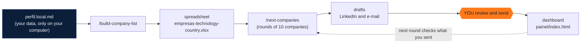

<p align="center">
  
</p>

<p align="center">
  <a href="LICENSE"></a>
  
  <a href="https://docs.claude.com/en/docs/claude-code/overview"></a>
  <a href="https://www.rtk-ai.app/"></a>
  <a href="https://roni-clei-santos.github.io/ai-company-prospector/demo/"></a>
</p>

<p align="center"><b>English</b> · <a href="README.md">Português</a></p>

> The agent's prompts, skills and guides are currently in Brazilian Portuguese (code and comments are in English). An English version is on the [roadmap](ROADMAP.md).

An agent for [Claude Code](https://docs.claude.com/en/docs/claude-code/overview) that flips the job search around: instead of waiting for the right opening, it **builds the list of companies that use your technology**, researches each one (open roles, recruiters, HR e-mails, freelance or partnership chances) and **leaves drafts ready for you to review and send**. It works in rounds of 10 companies, remembers everything between rounds, and keeps a dashboard up to date.

<p align="center">
  <a href="https://roni-clei-santos.github.io/ai-company-prospector/demo/"></a>
  <br><sub>Demo dashboard with 100% fictitious data. <a href="https://roni-clei-santos.github.io/ai-company-prospector/demo/">Open the live demo</a>.</sub>
</p>

## Requirements

- macOS (`install.sh` is Mac-only; Windows and Linux are not supported yet);
- [Homebrew](https://brew.sh);
- Python 3.9 or newer;
- Git;
- [Claude Code](https://docs.claude.com/en/docs/claude-code/overview) installed and signed in, with a Claude account that gives access to Claude Code;
- Google Chrome with the Claude in Chrome extension connected ([Chrome guide](docs/guia/03-chrome.md));
- a LinkedIn account, signed in on that Chrome.

## Quick start

```bash
git clone https://github.com/roni-clei-santos/ai-company-prospector.git
cd ai-company-prospector
./install.sh
```

1. **`./install.sh`**: checks Homebrew, Python and RTK, installs the skills into Claude Code and creates your `perfil.local.md` (fill it with your data: [profile guide](docs/guia/02-perfil.md), in Portuguese).
2. **`/chrome` and LinkedIn login**: open Claude Code in the folder, run `/chrome` and sign in to LinkedIn in Chrome ([Chrome guide](docs/guia/03-chrome.md)).
3. **`/build-company-list`**: answer 6 questions and get the company spreadsheet. Then, every round: **`/next-companies`**.

Full step-by-step guide: [docs/guia](docs/guia/01-instalacao.md).

## How it works



| Step | What happens |
|---|---|
| `perfil.local.md` | The single source of truth about you: dated work history, skills (have / partial / don't have), salary floors, tone of voice, companies to exclude. Nothing outside it is ever claimed. |
| `/build-company-list` | Searches official partner directories, Clutch, TheirStack, events, ecosystem partners, job posts and case studies. Every company comes with evidence and a source link; "Provável" (probable) rows are yellow. |
| `/next-companies` | Checks what you sent since the last round, processes the next 10 companies, scores each job (75% fit rule), builds a tailored CV and drafts, records everything and stops. |
| Dashboard | `painel/index.html`: this round, the whole project, who replied and dated follow-ups. |

## Principles

- **AI drafts, humans decide.** Messages and e-mails are always drafts. Management roles never get an automatic application.
- **LinkedIn is read-only.** It opens sent invitations, messages, jobs and company pages. It never sends, accepts, withdraws, likes or follows.
- **Memory between rounds.** `controle/progresso.json` keeps each company's status and the cut-off date; nothing is redone and no contact is repeated.
- **Nothing leaves without review.** E-mail stays as a file (`modo_email: "arquivo"`) or as a Gmail draft (`"gmail_rascunho"`). You read, edit and send.
- **It never makes things up.** Every statement about you comes from your profile, your CV or your answers. When in doubt, it asks.

## Layout

```
PROMPT-prospeccao.md        the agent's full rules (generic)
perfil.example.md           profile template (copy to perfil.local.md)
skills/                     /build-company-list, /next-companies and the shared preflight
scripts/                    registrar, montar_planilha, gerar_cv, checar_notas, gerar_painel, migrar_status
painel/index.html           dashboard (HTML + CSS + JS, no build step)
docs/guia/                  step-by-step guide · docs/demo/ = GitHub Pages demo
tests/                      pytest
```

Your data (`perfil.local.md`, `controle/`, `rascunhos/`, `relatorios/`, `evidencias/`, `curriculos/`, spreadsheets and PDFs) stays **only on your computer**: it is in `.gitignore`.

## Disclaimer

LinkedIn's terms restrict automation. This project only reads, in the person's own logged-in browser, screens that they would see themselves. Use at your own risk.

## Contributing

See [CONTRIBUTING.md](CONTRIBUTING.md) and the [ROADMAP.md](ROADMAP.md). Run the tests with `python3 -m pytest`.

## Author

Made by **Roni Clei J. Santos**, Adobe Commerce / Magento developer: [linkedin.com/in/roni-clei-santos](https://www.linkedin.com/in/roni-clei-santos/).

If this project helped you find a company (or stop job-hunting in the dark), **leave a ⭐** on the repository. It helps other people find it.

[MIT](LICENSE) license.
