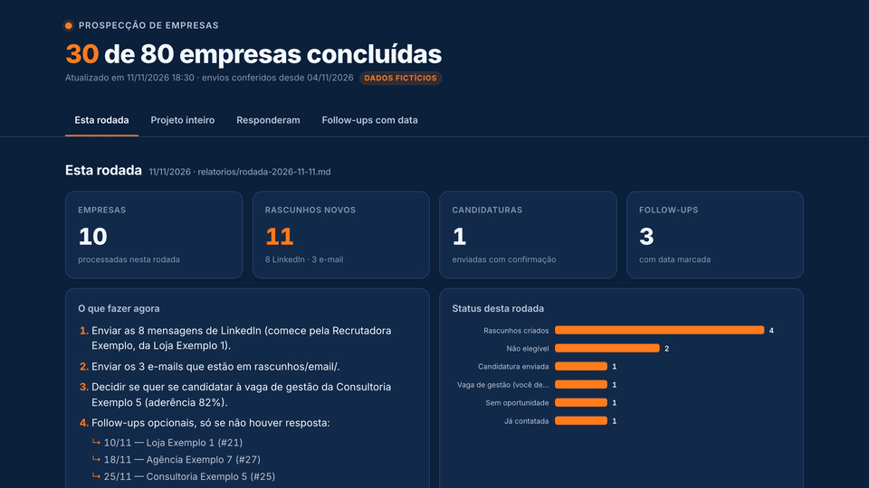
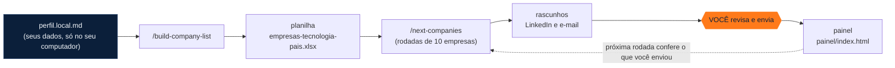

<p align="center">
  
</p>

<p align="center">
  <a href="LICENSE"></a>
  
  <a href="https://docs.claude.com/en/docs/claude-code/overview"></a>
  <a href="https://www.rtk-ai.app/"></a>
  <a href="https://roni-clei-santos.github.io/ai-company-prospector/demo/"></a>
</p>

<p align="center"><a href="README.en.md">English</a> · <b>Português</b></p>

Um agente para o [Claude Code](https://docs.claude.com/en/docs/claude-code/overview) que inverte a busca de emprego: em vez de esperar a vaga certa aparecer, ele **monta a lista de empresas que usam a sua tecnologia**, investiga uma por uma (vagas, recrutadores, e-mails de RH, chance de freela ou parceria) e **deixa os rascunhos prontos para você revisar e enviar**. Tudo em rodadas de 10 empresas, com memória entre as rodadas e um painel que se atualiza sozinho.

<p align="center">
  <a href="https://roni-clei-santos.github.io/ai-company-prospector/demo/"></a>
  <br><sub>Painel da demonstração, com dados 100% fictícios. <a href="https://roni-clei-santos.github.io/ai-company-prospector/demo/">Abrir a demo ao vivo</a>.</sub>
</p>

## Requisitos

- macOS (o `install.sh` é só para Mac; Windows e Linux ainda não são suportados);
- [Homebrew](https://brew.sh);
- Python 3.9 ou mais novo;
- Git;
- [Claude Code](https://docs.claude.com/en/docs/claude-code/overview) instalado e logado, com uma conta do Claude que dê acesso ao Claude Code;
- Google Chrome com a extensão Claude in Chrome conectada ([guia do Chrome](docs/guia/03-chrome.md));
- uma conta no LinkedIn, logada nesse Chrome.

## Começo rápido

```bash
git clone https://github.com/roni-clei-santos/ai-company-prospector.git
cd ai-company-prospector
./install.sh
```

1. **`./install.sh`**: confere Homebrew, Python e RTK, instala as skills no Claude Code e cria o seu `perfil.local.md` (preencha com os seus dados: [guia do perfil](docs/guia/02-perfil.md)).
2. **`/chrome` e login no LinkedIn**: abra o Claude Code na pasta, rode `/chrome` e entre no LinkedIn no Chrome ([guia do Chrome](docs/guia/03-chrome.md)).
3. **`/build-company-list`**: responda às 6 perguntas e receba a planilha de empresas. Depois, a cada rodada: **`/next-companies`**.

Guia completo, passo a passo: [docs/guia](docs/guia/01-instalacao.md).

## Como funciona



| Etapa | O que acontece |
|---|---|
| `perfil.local.md` | A única fonte de verdade sobre você: histórico com datas, skills (tem / parcial / não tem), pisos salariais, tom de voz, empresas a excluir. Nada fora dele é afirmado. |
| `/build-company-list` | Pesquisa diretórios oficiais de parceiros, Clutch, TheirStack, eventos, ecossistema, vagas e cases. Cada empresa entra com evidência e link; "Provável" fica em amarelo. |
| `/next-companies` | Confere o que você enviou desde a última rodada, processa as próximas 10 empresas, calcula a aderência de cada vaga (regra dos 75%), gera currículo ajustado e rascunhos, grava tudo e para. |
| Painel | `painel/index.html`: esta rodada, o projeto inteiro, quem respondeu e os follow-ups com data. |

## Princípios

- **A IA rascunha, o humano decide.** Mensagens e e-mails são sempre rascunhos. Vaga de gestão nunca recebe candidatura automática.
- **No LinkedIn, só leitura.** Abre convites enviados, mensagens, vagas e páginas de empresas. Nunca envia, aceita, retira convite, curte ou segue.
- **Memória entre rodadas.** `controle/progresso.json` guarda o status de cada empresa e a data de corte; nada é refeito e nenhum contato é repetido.
- **Nada sai sem revisão.** O e-mail fica em arquivo (`modo_email: "arquivo"`) ou como rascunho no Gmail (`"gmail_rascunho"`). Você lê, ajusta e envia.
- **Nunca inventa.** Toda afirmação sobre você sai do seu perfil, do seu currículo ou das suas respostas. Na dúvida, ele pergunta.

## Estrutura

```
PROMPT-prospeccao.md        regras completas do agente (genéricas)
perfil.example.md           modelo do perfil (copie para perfil.local.md)
skills/                     /build-company-list, /next-companies e o preflight compartilhado
scripts/                    registrar, montar_planilha, gerar_cv, checar_notas, gerar_painel, migrar_status
painel/index.html           painel (HTML + CSS + JS, sem build)
docs/guia/                  guia passo a passo · docs/demo/ = demo do GitHub Pages
tests/                      pytest
```

Seus dados (`perfil.local.md`, `controle/`, `rascunhos/`, `relatorios/`, `evidencias/`, `curriculos/`, planilhas e PDFs) ficam **só no seu computador**: estão no `.gitignore`.

## Aviso

Os termos do LinkedIn restringem automação. Este projeto só lê, no navegador logado da própria pessoa, telas que ela mesma veria. Use sob sua responsabilidade.

## Contribuir

Veja [CONTRIBUTING.md](CONTRIBUTING.md) e o [ROADMAP.md](ROADMAP.md). Rode os testes com `python3 -m pytest`.

## Autor

Feito por **Roni Clei J. Santos**, desenvolvedor Adobe Commerce / Magento: [linkedin.com/in/roni-clei-santos](https://www.linkedin.com/in/roni-clei-santos/).

Se este projeto te ajudou a achar uma empresa (ou a parar de procurar vaga no escuro), **deixe uma ⭐** no repositório. Isso ajuda outras pessoas a encontrarem o projeto.

Licença [MIT](LICENSE).
