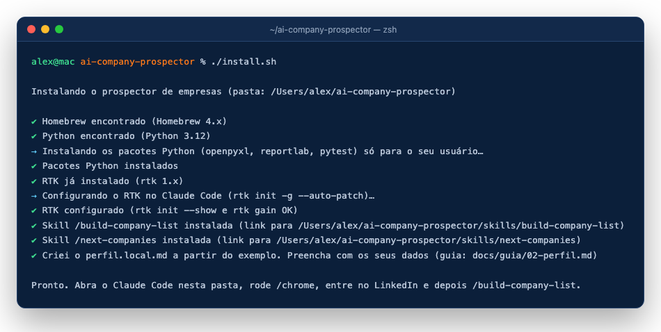

# 1. Instalação (macOS)

[Próximo: o perfil →](02-perfil.md)

## Requisitos

- macOS (o `install.sh` é só para Mac; Windows e Linux ainda não são suportados);
- [Homebrew](https://brew.sh);
- Python 3.9 ou mais novo;
- Git;
- [Claude Code](https://docs.claude.com/en/docs/claude-code/overview) instalado e logado, com uma conta do Claude que dê acesso ao Claude Code;
- Google Chrome com a extensão Claude in Chrome conectada ([guia do Chrome](03-chrome.md));
- uma conta no LinkedIn, logada nesse Chrome.

## Passo a passo

```bash
git clone https://github.com/roni-clei-santos/ai-company-prospector.git
cd ai-company-prospector
./install.sh
```

O instalador:

1. confere o Homebrew (se faltar, mostra o comando oficial e para);
2. confere o `python3` e instala `openpyxl`, `reportlab` e `pytest` só para o seu usuário (`pip3 install --user`);
3. instala o [RTK](https://www.rtk-ai.app/) com `brew install rtk` (se ainda não tiver) e liga o RTK no Claude Code (`rtk init -g --auto-patch`), conferindo com `rtk init --show` e `rtk gain`;
4. cria os links das skills `/build-company-list` e `/next-companies` em `~/.claude/skills/` (se já existir uma pasta com o mesmo nome, ela é guardada em `~/.claude/skills.backup/<nome>.backup-AAAAMMDD`);
5. copia `perfil.example.md` para `perfil.local.md`, se ainda não existir.

Pode rodar de novo quando quiser: ele não estraga nada que já está pronto.



> Não use `cargo install rtk`: esse é outro pacote, com o mesmo nome.

## Conferir

```bash
python3 -m pytest      # os testes devem passar
ls -la ~/.claude/skills/   # build-company-list e next-companies apontam para esta pasta
```

[Próximo: o perfil →](02-perfil.md)
