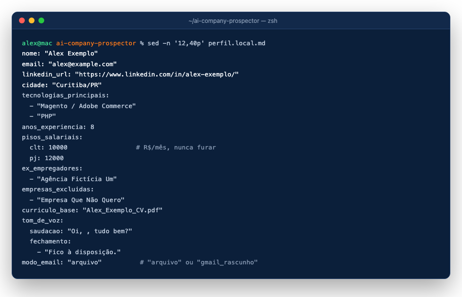

# 2. O seu perfil (`perfil.local.md`)

[← Instalação](01-instalacao.md) · [Próximo: Chrome →](03-chrome.md)

O `perfil.local.md` é a **única fonte de verdade sobre você**. O agente só afirma o que estiver nele, no PDF do seu currículo, no seu LinkedIn ou no arquivo de respostas. Ele fica só no seu computador (está no `.gitignore`).

Abra o arquivo e troque os dados do exemplo (Alex Exemplo) pelos seus.

## Campos obrigatórios

| Campo | O que é | Exemplo |
|---|---|---|
| `nome` | seu nome como vai nos e-mails | `"Alex Exemplo"` |
| `email` | seu e-mail | `"alex@example.com"` |
| `linkedin_url` | URL do seu perfil | `"https://www.linkedin.com/in/alex-exemplo/"` |
| `cidade` | cidade/UF | `"Curitiba/PR"` |
| `tecnologias_principais` | lista; a primeira é o padrão do `/build-company-list` | `["Magento / Adobe Commerce", "PHP"]` |
| `anos_experiencia` | número | `8` |
| `pisos_salariais` | `clt` e `pj`, por mês; nunca são furados | `clt: 10000`, `pj: 12000` |
| `idiomas` | lista com `idioma` e `nivel`; use `"não informar"` ou `"nunca citar"` quando for o caso | |
| `ex_empregadores` | lista; entram na planilha marcados | |
| `empresas_excluidas` | lista; nunca são prospectadas | |
| `curriculo_base` | nome do PDF do seu currículo, na pasta do projeto | `"Alex_Exemplo_CV.pdf"` |
| `tom_de_voz` | `saudacao` (com `<nome>`) e `fechamento` (lista de frases) | `"Oi, <nome>, tudo bem?"` |
| `modo_email` | `"arquivo"` (rascunhos só em `rascunhos/email/*.md`) ou `"gmail_rascunho"` (rascunho no Gmail pelo navegador; nunca envia) | `"arquivo"` |

## Seções de texto (importantes)

- **Histórico profissional (datas exatas)**: uma linha por emprego, com cargo e datas. É o que vale para o currículo ajustado e para o cálculo de anos.
- **Skills**: três listas, "Tem (ATENDE)", "Conhece, mas não é especialista (PARCIAL)" e "NÃO tem (NÃO ATENDE)". Elas definem a aderência de cada vaga (regra dos 75%).
- **Objetivo de carreira**: o que você quer e o que não quer (vira filtro eliminatório).
- **Tom de voz (detalhes)** e **Pistas de contato já dadas**.

## Campos opcionais úteis

`planilha_empresas` (preenchido pelo `/build-company-list`), `arquivo_respostas`, `marca_freela`, `modalidade`, `fontes_proibidas`, `palavras_proibidas` (o `scripts/checar_notas.py` acusa essas frases nos rascunhos) e os assuntos de e-mail.

## Currículo ajustado (opcional)

Para gerar um PDF por vaga, copie `examples/cv-base.example.json` para `controle/cv-base.json` e preencha com os mesmos fatos do perfil. O `scripts/gerar_cv.py` só muda resumo, ordem e destaques; cargos e datas vêm sempre desse arquivo.

[← Instalação](01-instalacao.md) · [Próximo: Chrome →](03-chrome.md)
