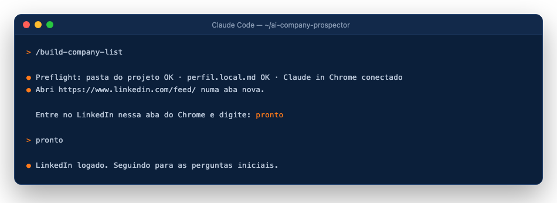

# 3. Chrome: extensão, `/chrome` e login

[← Perfil](02-perfil.md) · [Próximo: a planilha →](04-planilha.md)

O `/next-companies` (modo "Planilha + robô") usa o **seu** Chrome, com as **suas** sessões, para ler o LinkedIn (e o Gmail, se você escolher `modo_email: "gmail_rascunho"`). O `/build-company-list` não precisa do LinkedIn: se o Chrome estiver conectado, ele só o usa para páginas que bloqueiam a busca normal; se não estiver, segue sem ele e anota na planilha as fontes que ficaram de fora.

1. Instale a extensão **Claude in Chrome** pela Chrome Web Store e entre com a mesma conta do Claude.
2. Abra o Claude Code na pasta do projeto e rode `/chrome`. Confirme que aparece como conectado.
3. Rode `/next-companies`. O primeiro passo (preflight) abre `https://www.linkedin.com/feed/` numa aba nova:
   - se você estiver logado, ele segue sozinho;
   - se cair na tela de login, ele para e pede: **"Entre no LinkedIn nessa aba do Chrome e digite: pronto."** Entre na sua conta nessa aba e digite `pronto` no Claude Code.

## O que o agente faz e o que nunca faz no LinkedIn

| Pode (só leitura) | Nunca |
|---|---|
| convites enviados, mensagens, abas Jobs e People de empresas, perfis, páginas de vaga | enviar, aceitar, retirar convite, responder, arquivar, apagar, seguir, curtir, conectar, Easy Apply, editar perfil |

Ele navega em ritmo humano. Se o LinkedIn mostrar aviso de limite ou verificação, ele para de usar o LinkedIn naquela rodada e avisa.

> Os termos do LinkedIn restringem automação. Este projeto só lê, no navegador logado da própria pessoa, telas que ela mesma veria. Use sob sua responsabilidade.

[← Perfil](02-perfil.md) · [Próximo: a planilha →](04-planilha.md)
