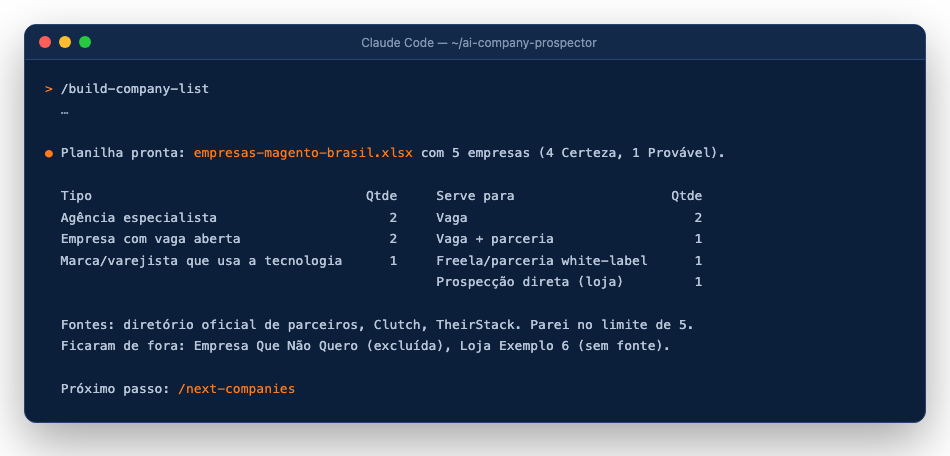

# 4. A planilha de empresas (`/build-company-list`)

[← Chrome](03-chrome.md) · [Próximo: a rodada →](05-rodada.md)

## Dois jeitos de usar

| | **Só a planilha** | **Planilha + robô** |
|---|---|---|
| Comando | `/build-company-list` | `/build-company-list` e depois `/next-companies` a cada rodada |
| Precisa de LinkedIn? | Não | Sim, logado no Chrome (extensão Claude in Chrome) |
| O que você recebe | Empresas reais que usam a sua tecnologia, cada uma com evidência e link da fonte | O fluxo completo: rodadas de 10 empresas, vagas avaliadas, rascunhos de LinkedIn e e-mail e o painel |
| Quem faz o contato | Você, por conta própria | Você envia os rascunhos que o robô preparou |

O `/build-company-list` **não precisa de LinkedIn**: o preflight dele confere só a pasta e o `perfil.local.md`. As fontes são pesquisadas na web; se o Chrome estiver conectado, ele ajuda em páginas que bloqueiam a busca normal (e no LinkedIn Jobs, se já estiver logado). Se não estiver, o robô segue sem ele e anota na aba **Resumo** as fontes que ficaram de fora.

## Rodando

Rode `/build-company-list`. Ele faz **uma** mensagem com 6 perguntas (os padrões vêm do seu perfil):

1. tecnologia/plataforma (ex.: "Magento / Adobe Commerce", "VTEX");
2. país ou região;
3. tipos de empresa (agências especialistas, consultorias grandes, agências multiplataforma, marcas que usam a tecnologia, empresas com vaga aberta, internacionais que contratam remoto na região, ecossistema);
4. objetivo (vaga, parceria, freela ou todos);
5. empresas a excluir;
6. ex-empregadores.

Depois ele pesquisa, nesta ordem: diretório oficial de parceiros da tecnologia → Clutch → TheirStack → eventos da comunidade → parceiros do ecossistema → vagas abertas que citam a tecnologia (nunca Indeed) → cases públicos. Para quando 3 buscas seguidas não trazem empresa nova.

Para testar rápido: `/build-company-list limite 5`.

## O que sai

`empresas-<tecnologia>-<pais>.xlsx`:

- aba **Empresas**: `#`, `Empresa`, `Tipo`, `Cidade/UF`, `Evidência`, `Confiança`, `Serve para`, `Observação`, `Fonte`;
- aba **Resumo**: contagem por tipo, por confiança e por "Serve para", as fontes que ficaram de fora (com o motivo) e a legenda.

Regras: toda linha tem link de fonte; sem duplicatas; nada inventado. **Certeza** = evidência direta e atual (vaga, site, case, diretório). **Provável** = evidência antiga ou indireta, em amarelo. Ex-empregadores ficam marcados em Observação; empresas excluídas não entram.

O `scripts/montar_planilha.py` aplica essas regras e cria o `controle/progresso.json` vazio, pronto para o `/next-companies` (nunca sobrescreve um que já existe).

No fim, o robô responde: "Sua planilha está pronta: <caminho do arquivo>. Você pode usar a lista e fazer os contatos por conta própria, ou deixar o robô pesquisar cada empresa e preparar os rascunhos: entre no LinkedIn no Chrome e rode /next-companies."

[← Chrome](03-chrome.md) · [Próximo: a rodada →](05-rodada.md)
