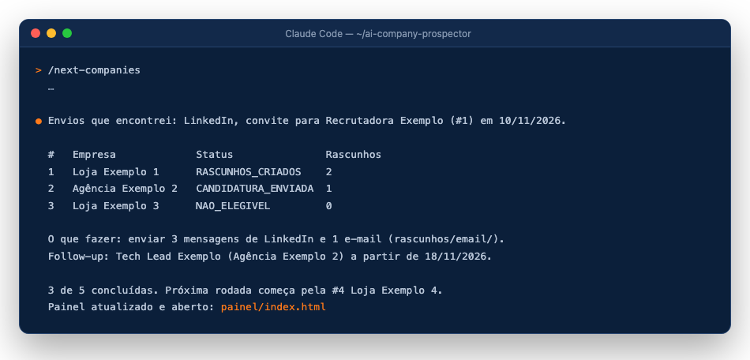

# 5. Uma rodada (`/next-companies`)

[← Planilha](04-planilha.md) · [Próximo: o painel →](06-painel.md)

Cada `/next-companies` faz **uma rodada** e para:

1. **Preflight**: pasta, perfil, Chrome e LinkedIn.
2. **Confere o que você enviou** desde a data de corte (`progresso.json > data_corte`): convites e mensagens no LinkedIn (só leitura) e, no modo Gmail, a pasta Enviados. Quem já recebeu não ganha rascunho novo. Quem respondeu aparece em "Responderam".
3. **Escolhe as próximas 10 empresas** na ordem combinada: vagas com "Certeza" → vagas "Provável" → freela/parceria → prospecção direta.
4. **Uma empresa de cada vez, do começo ao fim**: histórico de contatos, canais (site, plataformas de vaga, LinkedIn), avaliação das vagas (filtros eliminatórios + aderência ≥ 75%), candidatura quando autorizada, rascunhos e relatório. Cada empresa é gravada com `scripts/registrar.py`, que atualiza o `progresso.json` e o `relatorio-final.xlsx` juntos.
5. **Fecha a rodada**: atualiza `relatorio-parcial.md`, cria `relatorios/rodada-AAAA-MM-DD.md`, grava a nova data de corte, roda `scripts/checar_notas.py` e `scripts/checar_nao_contatar.py` e abre o painel.

Para processar menos empresas: `/next-companies limite 3`.

Entre uma rodada e outra, `/painel` só reabre o painel na aba Pendentes, sem processar empresa nenhuma e sem abrir o LinkedIn ou o Gmail ([o painel](06-painel.md)). A conferência do que você enviou fica no passo 1 da próxima rodada.

## Status de cada empresa

`CANDIDATURA_ENVIADA`, `RASCUNHOS_CRIADOS`, `SEM_OPORTUNIDADE`, `JA_CONTATADA_SEM_NOVA_ACAO`, `NAO_ELEGIVEL`, `PULADA_PELO_CANDIDATO`, `DESISTENCIA_DO_CANDIDATO`, `PRECISA_DO_CANDIDATO`, `AGUARDANDO_RESPOSTA_CANDIDATO`, `ERRO`, `VAGA_GESTAO_PARA_O_CANDIDATO_DECIDIR`. O status é só o nome; a data vai no campo `data`.

## Você revisa e envia

- **LinkedIn**: `rascunhos/linkedin/<numero>-<empresa>.md`, com perfil, tipo (mensagem ou nota de convite, até 200 caracteres) e texto pronto.
- **E-mail**: `rascunhos/email/*.md` (modo `"arquivo"`) ou a pasta Rascunhos do Gmail (modo `"gmail_rascunho"`).

Na rodada seguinte, o agente confere o que foi enviado e registra sozinho.

[← Planilha](04-planilha.md) · [Próximo: o painel →](06-painel.md)
