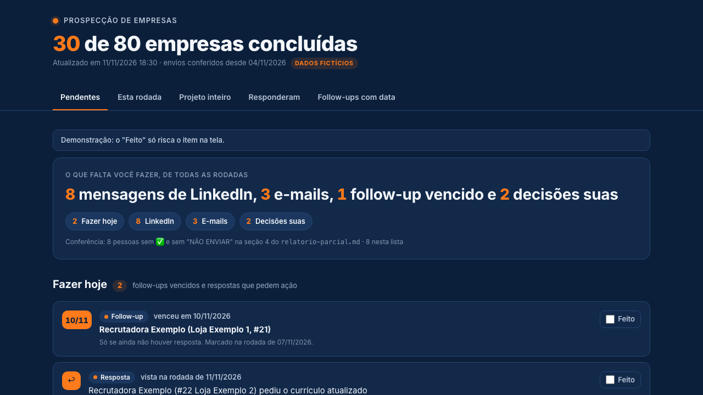
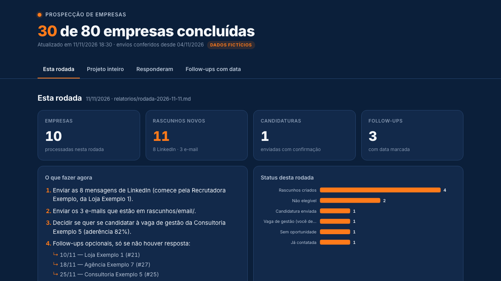
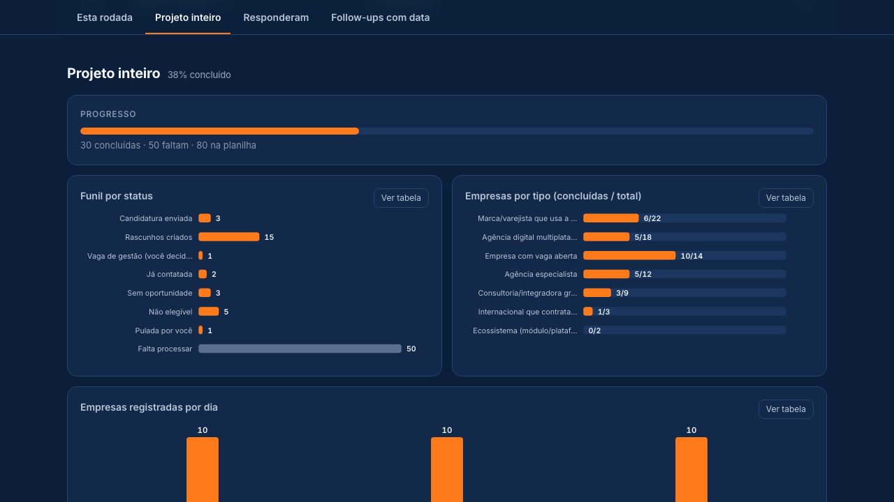
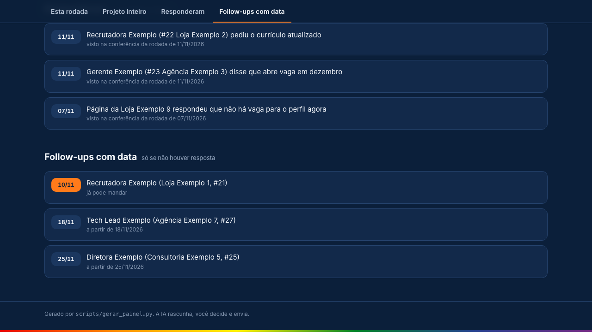

# 6. O painel

[← Rodada](05-rodada.md) · [Próximo: FAQ e erros →](07-faq-e-erros.md)

O painel é o lugar onde você vê tudo o que precisa fazer, de todas as rodadas, sem abrir outro arquivo. Ao fim de cada rodada, o `/next-companies` roda `python3 scripts/gerar_painel.py`, que grava os dados, liga o servidor local e abre o painel no navegador padrão (macOS, Linux e Windows), já na aba **Pendentes**.

**Como abrir:** Dê duplo clique em painel/index.html, ou rode /painel. Se o painel for aberto direto e a gravação estiver desligada, o clique fica guardado e é salvo sozinho na próxima vez que o /painel ou o robô rodar.

Nada sai do seu computador. O botão Feito grava no projeto por um programinha que roda só no seu computador, só enquanto o painel está em uso. Esse programa é o `scripts/servidor_painel.py`. Ele usa só a biblioteca padrão do Python e escuta em `http://127.0.0.1:47321` (se a porta estiver ocupada, tenta da 47322 à 47330). Só aceita pedidos deste computador que tragam a chave do projeto (`controle/.painel-token`, criada uma vez). Para sozinho 30 minutos depois do último uso; enquanto o painel está aberto, a página avisa a cada minuto que ainda está em uso. Nada liga junto com o computador.

## `/painel`: abrir o painel de qualquer pasta

Digite no Claude Code, em qualquer pasta:

```
/painel
```

Ele só roda `scripts/gerar_painel.py`: regenera os dados, liga o servidor se estiver parado e abre o painel. **Não abre o LinkedIn, o Gmail nem o Chrome**, não processa empresa e não cria rascunho. A conferência do que você enviou fica no `/next-companies` (passo 1 de cada rodada).

O projeto é encontrado nesta ordem: a variável `PROSPECT_DIR`; o caminho gravado em `~/.config/ai-company-prospector/projeto` (Windows: `%APPDATA%\ai-company-prospector\projeto`), que o instalador e o painel gravam; a pasta atual. Se nenhum tiver `controle/progresso.json`, aparece "Não achei o projeto. Rode o instalador na pasta do projeto."

Pelo terminal:

```bash
python3 scripts/gerar_painel.py             # macOS e Linux (liga o servidor e abre o painel)
py -3 scripts\gerar_painel.py               # Windows
python3 scripts/gerar_painel.py --no-open   # só atualiza os dados, sem servidor e sem navegador
python3 scripts/gerar_painel.py --arquivo   # abre o painel sem ligar o servidor (os cliques ficam guardados)
```

O script lê `relatorio-parcial.md` (seções 2, 3 e 4), os rascunhos de `rascunhos/linkedin/` e `rascunhos/email/`, `controle/progresso.json`, todos os `relatorios/rodada-*.md` e `relatorio-final.xlsx`. Ele grava `painel/data.json`, `painel/data.js`, `painel/servidor.js` e os relatórios em HTML de `painel/relatorios/`, tudo dado pessoal e fora do git.

**Demo com dados fictícios:** [roni-clei-santos.github.io/ai-company-prospector/demo](https://roni-clei-santos.github.io/ai-company-prospector/demo/)

## Pendentes (a primeira aba)

No topo, os totais: "X mensagens de LinkedIn, Y e-mails, Z follow-ups vencidos e W decisões suas". Depois, nesta ordem:

- **Fazer hoje:** follow-ups com data vencida ou igual a hoje e respostas recebidas que pedem uma ação sua (ex.: "pediu o currículo"). Resposta que você já respondeu não entra.
- **LinkedIn:** todas as mensagens ainda não enviadas, de todas as rodadas, numeradas 1, 2, 3… na ordem de prioridade do PROMPT (seção 6.0: vaga com "Certeza", vaga "Provável", freela/parceria, prospecção direta; dentro de cada grupo, pela coluna `#`). Cada item mostra empresa, nome, cargo, tipo (convite com nota ou mensagem direta), o texto completo, **Abrir perfil** e **Copiar texto**. Quando o rascunho tem a mensagem para depois que a pessoa aceitar, ela fica logo abaixo, com o próprio botão de copiar.
- **E-mails:** cada rascunho pendente, com destinatário, assunto e o botão **Abrir Rascunhos do Gmail** (no modo `arquivo`, o texto do e-mail com **Copiar texto**).
- **Decisões suas:** vagas em que o robô não se candidatou e deixou para você (vaga de gestão, idioma acima do seu perfil etc.), com o motivo e o link da vaga.

### "Feito": marcou, está registrado

Cada item tem a caixinha **Feito**, que funciona do jeito que você abrir o painel: duplo clique no `index.html`, favorito, `/painel` ou o robô. Ao clicar, o item é riscado e vai na hora para **Enviados hoje**. O painel então avisa o servidor local, que chama o `scripts/registrar.py` e grava o item como ENVIADO com a data de hoje em todos os lugares onde o robô registra envio: `controle/progresso.json` (histórico), `relatorio-parcial.md` (✅ na seção 3 ou 4), o relatório da empresa em `relatorios/`, o arquivo do rascunho, `controle/historico-contatos.md` e a linha da empresa no `relatorio-final.xlsx`. Gravado, aparece **"Marcou como Feito, está registrado."** O botão **Desfazer** reverte exatamente o que foi gravado.

Se o servidor estiver desligado (por exemplo, painel aberto direto, mais de 30 minutos depois do último uso), o clique não se perde. Ele fica guardado no navegador e aparece: **"Marcado. Vou salvar no projeto na próxima vez que o painel for aberto pelo /painel ou pelo robô. (N cliques guardados)"**. Quando o servidor volta, a página manda os cliques guardados, na ordem, e mostra o estado real do projeto. Ela tenta ao abrir, a cada clique, a cada 10 segundos e quando você volta para a aba. Mandar o mesmo clique duas vezes não grava duas vezes.

O seu clique é a fonte da verdade. A conferência no LinkedIn e no Gmail (no passo 1 de cada rodada do `/next-companies`) continua só para os itens que você NÃO marcou, para pegar envios que você esqueceu de marcar, e para as respostas recebidas. Ela nunca desmarca um item que você marcou. Na demo do GitHub Pages, o "Feito" só risca o item na tela (aviso "demonstração").

**Relatório da empresa:** o botão abre o relatório da empresa como página (`painel/relatorios/<nome>.html`, gerada a partir do `.md`), com "Voltar ao painel" no topo. Funciona igual com o painel aberto do arquivo ou pelo servidor. O nome do relatório da rodada, na aba Última rodada, também abre a página dele.

Pessoas e empresas marcadas `NAO_CONTATAR` nunca aparecem como pendentes. Seção vazia mostra "Nada pendente aqui". Abaixo dos totais, a linha **Conferência** compara o total de LinkedIn da aba com as pessoas sem ✅ e sem "NÃO ENVIAR" na seção 4 do `relatorio-parcial.md`; se não baterem, ela fica amarela.



## Última rodada

Empresas, rascunhos novos, candidaturas, follow-ups, "O que fazer agora", status da rodada e a tabela das empresas.



## Projeto inteiro

Progresso X de N, funil por status, empresas por tipo (concluídas / total) e empresas registradas por dia. Todo gráfico tem o botão **Ver tabela**.



## Responderam e Follow-ups com data

Quem respondeu nas últimas rodadas e todos os follow-ups marcados (em laranja, os que já podem ser enviados).



## Para quem contribui

A demo do GitHub Pages (`docs/demo/`) é uma cópia do painel que lê `painel/demo-data.json`. Depois de mudar `painel/index.html` ou os dados de demo, rode `python3 scripts/gerar_painel.py --demo`. As abas também abrem por link: `index.html#pendentes`, `#rodada`, `#projeto`, `#responderam`, `#followups`.

[← Rodada](05-rodada.md) · [Próximo: FAQ e erros →](07-faq-e-erros.md)
