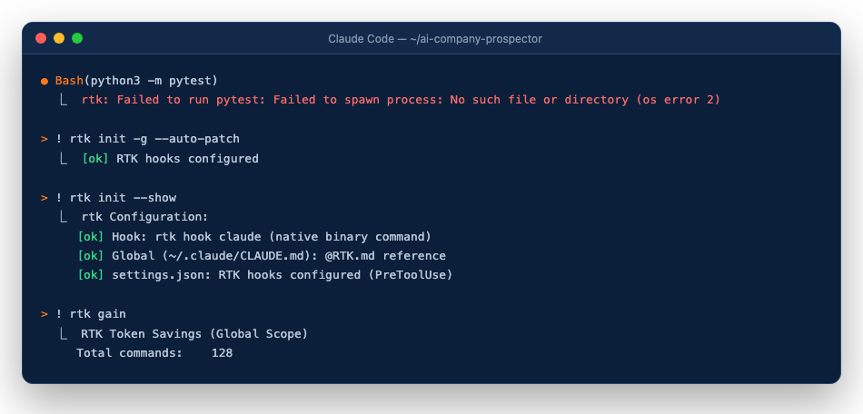

# 7. FAQ e erros comuns

[← Painel](06-painel.md) · [Início](01-instalacao.md)

## O hook do RTK está bloqueando ferramentas

Sintoma: um comando falha com algo como `rtk: Failed to run pytest: Failed to spawn process` ou o Claude Code não consegue rodar ferramentas.



Correção, digitando no próprio Claude Code (o `!` roda o comando direto, sem passar pelo agente):

```
! rtk init -g --auto-patch
! rtk init --show
! rtk gain
```

Se o erro for de um programa que não está no PATH (como o `pytest` instalado com `--user`), rode pelo Python: `python3 -m pytest` (Windows: `py -3 -m pytest`), ou acrescente ao PATH a pasta de scripts do usuário: `~/Library/Python/3.x/bin` no macOS, `~/.local/bin` no Linux.

## O `controle/progresso.json` está corrompido

O `/next-companies` para sem mexer em nada e mostra a linha do erro. O `controle/` é pessoal e **não vai para o git do projeto**, então há dois jeitos de restaurar:

1. **Cópias automáticas**: o `scripts/registrar.py` guarda uma cópia antes de cada gravação (as 30 últimas):
   ```bash
   ls -t controle/.backups/progresso-*.json | head -3
   cp "$(ls -t controle/.backups/progresso-*.json | head -1)" controle/progresso.json
   ```
2. **Git local e privado só para o `controle/`** (recomendado; nunca é publicado):
   ```bash
   git -C controle init && git -C controle add -A && git -C controle commit -m "estado inicial"
   # depois de cada rodada: git -C controle add -A && git -C controle commit -m "rodada"
   # para restaurar: git -C controle checkout -- progresso.json
   ```

Confira o arquivo com `python3 -m json.tool controle/progresso.json` antes de rodar de novo.

## O LinkedIn está deslogado

O preflight para com: "Entre no LinkedIn nessa aba do Chrome e digite: pronto." Entre na conta nessa aba e digite `pronto`. Se o LinkedIn pedir verificação (código, CAPTCHA), resolva você mesmo; o agente nunca digita senha nem resolve CAPTCHA.

## O Chrome está desconectado

Mensagem: "Instale a extensão Claude in Chrome e rode /chrome no Claude Code (guia: docs/guia/03-chrome.md)." Confira se a extensão está instalada e logada, rode `/chrome` e tente de novo.

## A planilha não tem a aba `Empresas`

Mensagem: "Não achei a planilha … (ou ela não tem a aba Empresas)." A aba precisa se chamar exatamente `Empresas`, com o cabeçalho na linha 1 (`#`, `Empresa`, `Tipo`, `Cidade/UF`, `Evidência`, `Confiança`, `Serve para`, `Observação`, `Fonte`). Gere de novo com `/build-company-list` ou renomeie a aba. Confira o campo `planilha_empresas` do `perfil.local.md`.

## O perfil ainda é o de exemplo

Mensagem: "Preencha o perfil.local.md (guia: docs/guia/02-perfil.md) e rode de novo." Troque os dados do Alex Exemplo pelos seus ([guia 2](02-perfil.md)).

## Uma nota de convite passou de 200 caracteres

Rode `python3 scripts/checar_notas.py`. Ele mostra `LONGA <n> <arquivo> <linha>`, `SEM NOTA` ou `ESTILO` (travessão longo ou frase de `palavras_proibidas`). Corrija o rascunho e rode de novo até aparecer `OK`.

## Atualizei de uma versão antiga

Status antigos com nome de pessoa (ex.: `PULADA_PELO_<NOME>`) e datas dentro do status são convertidos por:

```bash
python3 scripts/migrar_status.py --dry-run          # mostra as contagens antes e depois
python3 scripts/migrar_status.py --data-corte AAAA-MM-DD
```

Ele só grava se as contagens baterem e guarda cópia em `controle/backup-migracao-*`.

[← Painel](06-painel.md) · [Início](01-instalacao.md)
