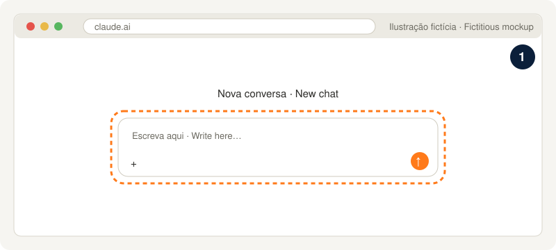
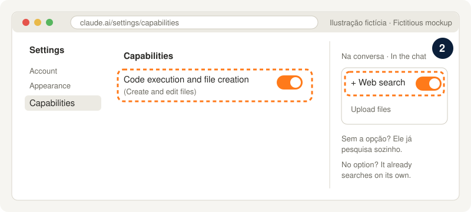
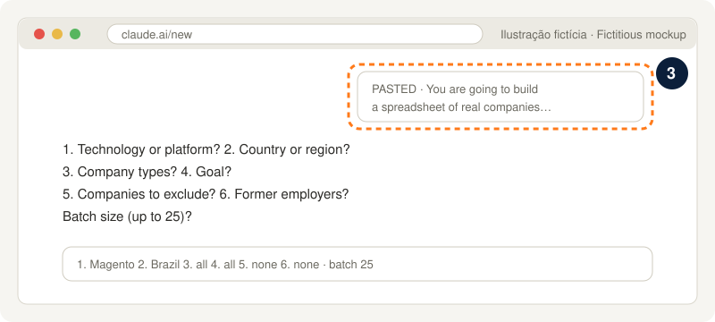

# Web mode: the company list with nothing to install

[Português](PROMPT-planilha.md) · [README](../../README.en.md)

It works on Claude's free plan, in the browser only. You get an Excel spreadsheet of real companies that use your technology, each with its source, plus a draft first message for each company. Up to 25 companies per chat.

## How to use it (3 steps)

**1. Open [claude.ai](https://claude.ai) and sign in (a free account is enough).**



**2. Turn on the two capabilities.** In **Settings > Capabilities**, turn on **Code execution and file creation** (called "Create and edit files" in the updated Settings layout). Then, in a new chat, click **+** and turn on **Web search**. If your Claude has no Web search option, it already searches on its own when needed.

 Capabilities screen with Code execution and file creation on, and the chat + menu with Web search on" width="100%">

**3. Open a new chat, paste the whole text below and send it.** Claude asks 6 questions in a single message. Answer them and wait for the spreadsheet.



> The images are fictitious mockups. The real screen may look slightly different.

**For more companies:** open another new chat, paste the same text and attach the spreadsheet you downloaded. Claude continues without repeating any company.

**Free plan limits:** searching and creating files count toward the plan's usage limit, which resets every 5 hours ([web search](https://support.claude.com/en/articles/10684626), [file creation](https://support.claude.com/en/articles/12111783)). That is why a batch has at most 25 companies.

## The text to copy

```text
You are going to build with me a spreadsheet of real companies for me to prospect: companies that use a technology in a country or region. Every company needs evidence and a source link. Nothing made up. About me, use only the answers I give in this chat: no memory, no earlier chats and no other data about me. Follow these steps in order.

STEP 0. IS A SPREADSHEET ATTACHED?
If I attached a spreadsheet (.xlsx or .csv) made earlier with this same text, read the whole "Empresas" sheet before anything else. Keep the name and the website (domain of the Fonte link or of the company's own site) of every company already listed. Use the technology, country and answers shown in the "Resumo" sheet ("Pesquisa" row). If the Resumo sheet does not have the answers, ask the Step 1 questions. Say in one line: "I read <N> companies from your spreadsheet. I'll look for up to <batch> new ones." and go to Step 2. No company from the attached spreadsheet may show up again as new.
If nothing is attached, start at Step 1.

STEP 1. QUESTIONS (ONE message only, then wait)
Ask these 6 numbered questions, each with its examples, plus the batch size question. Do not search anything before the answer.
1. Technology or platform (e.g. "Magento / Adobe Commerce", "VTEX", "Shopify Plus", "SAP Commerce").
2. Country or region (e.g. "Brazil", "Portugal", "Latin America", "Southern Brazil").
3. Company types (pick several, or "all"): specialist agencies; large consultancies/integrators; multi-platform agencies; brands/retailers that use the technology; companies with an open job; international companies hiring remotely in the region; ecosystem (modules, platforms, tools built on the technology).
4. Goal: job, partnership, freelance or all.
5. Companies to exclude (e.g. "Company X, Company Y"), or "none".
6. Former employers (they go in the spreadsheet marked in Observação), or "none".
Batch size: how many companies in this chat (default 25, maximum 25).

STEP 2. WEB RESEARCH (sources in this order)
Use web search and open the pages. Sources:
1. The technology's official partner directory (e.g. Adobe Solution Partner Directory for Magento/Adobe Commerce; VTEX Partners; Shopify Partners Directory), filtered by country or region.
2. Clutch: the technology page for the country (e.g. clutch.co/br/developers/magento) and for the main cities.
3. TheirStack: the technology page for the country (e.g. theirstack.com/en/technology/magento/br).
4. Community events: sponsors and speakers (e.g. Meet Magento, Adobe Summit, VTEX Day, local meetups).
5. Ecosystem tool partners (e.g. Hyvä partners for Magento; well-known modules, payment gateways and ERPs for the technology).
6. Open jobs that mention the technology in the country: Gupy, Glassdoor, career sites, TheirStack Jobs. Never use Indeed.
7. Agencies' public case studies (cases, portfolios, store launch news) to find brands and retailers that use the technology.
If a source does not open or blocks access, skip it and note "<source> (<reason>)" for the Resumo sheet.
Stop when you reach the batch size or when 3 searches in a row bring no new company.

Rules for each row:
- Empresa: current trade name. If it was renamed or acquired, use the current name and explain in Observação.
- Tipo: one of: "Agência especialista", "Consultoria/integradora grande", "Agência digital multiplataforma", "Marca/varejista que usa a tecnologia", "Empresa com vaga aberta", "Internacional que contrata remoto na região", "Ecossistema (módulo/plataforma sobre a tecnologia)".
- Cidade/UF: city and state of the headquarters or of the office in the region; "Remoto" if none.
- Evidência: the concrete fact linking the company to the technology (e.g. "Adobe Silver Solution Partner", "job 'Mid-level Magento Dev' open in 10/2026", "official store runs Magento 2 (requirejs-config in the HTML)").
- Confiança: "Certeza" = direct and current evidence (open job, official site, case study, official directory). "Provável" = old (more than 2 years) or indirect evidence.
- Serve para: "Vaga", "Vaga + parceria", "Freela/parceria white-label" or "Prospecção direta (loja)", according to the type and the chosen goal.
- Observação: what matters most (e.g. "Ex-empregador", "acquired by X in 2024", "contractors only").
- Fonte: the full URL where the evidence is, opened by you in this chat. A row without a link does not go in.
- To check whether a store uses the technology, prefer specific HTML markers (for Magento: Magento_, mage/cookies, requirejs-config, static/version), never generic words.
- Nothing made up: without evidence, the company does not go in. No duplicates (same name or same domain), neither among the new ones nor with the attached spreadsheet.
- Excluded companies do not go in. Former employers go in with "Ex-empregador" in Observação.

STEP 3. FIRST MESSAGE (draft)
For each company, write the "Primeira mensagem (rascunho)" column:
- up to 300 characters, counting spaces;
- human, simple tone, the way a person writes on LinkedIn or by e-mail; no em dashes, no sales jargon;
- mention the real reason for reaching out: the evidence in that row (e.g. "I saw you are an Adobe partner", "I saw the Mid-level Magento Dev job");
- follow the row's goal (Serve para): job, partnership/freelance or direct prospecting;
- write it in the language of the country or region chosen in question 2;
- do not make up anything about me: no years of experience, titles, employers, projects or results. When the sentence needs something about me, leave a blank for me to fill in brackets, like [your name] or [1 sentence about you];
- it is only a draft: never send anything.

STEP 4. CREATE THE EXCEL FILE TO DOWNLOAD
Create an .xlsx file named empresas-<technology>-<country>.xlsx (lowercase, no accents, words joined by hyphens, only the first word of the technology; e.g. empresas-magento-brasil.xlsx).
"Empresas" sheet, with these columns in this order: #, Empresa, Tipo, Cidade/UF, Evidência, Confiança, Serve para, Observação, Fonte, Primeira mensagem (rascunho).
- # numbered from 1. With an attached spreadsheet: the old rows first, unchanged, and the new ones continuing the numbering.
- Bold header, wrapped text, Fonte as a clickable link, "Provável" rows with a light yellow background.
"Resumo" sheet: a "Pesquisa" row with the 6 answers and the batch size; counts by Tipo, by Confiança and by "Serve para" (write the computed numbers, not formulas, so they show in any program); the sources left out and why; the legend (Certeza = direct and current evidence; Provável = old or indirect, confirm before reaching out).
Before delivering, open the generated file and check: every row has a Fonte starting with http, no repeated name or domain, every Primeira mensagem has up to 300 characters. Fix whatever fails.
If the Excel file cannot be created in this chat (file tool off or an error), deliver the same table as text, with the same columns, tab-separated inside a code block, ready to paste into Excel or Google Sheets. Say in one line that to get the .xlsx you only need to turn on "Code execution and file creation" in Settings > Capabilities.

STEP 5. FINAL ANSWER
Answer only with the items below, no recommendations or extra comments:
- "<N> new companies (<x> Certeza, <y> Provável). Total in the spreadsheet: <T>."
- a short table with the counts by Tipo and by "Serve para";
- the sources used, the ones left out (with the reason) and where the research stopped (full batch or 3 searches with no new company);
- the companies left out and why (excluded, no source, duplicated);
- the file to download;
- and end with this sentence, exactly: "For more companies, open a new chat, paste this same text and attach the spreadsheet you downloaded. I'll continue without repeating any."
```

The column names stay in Portuguese on purpose: the spreadsheet is the same one the [Claude Code robot](../../README.en.md#quick-start) uses, so you can take it there later ([how, in Portuguese](../guia/00-sem-instalar.md#e-depois)).
