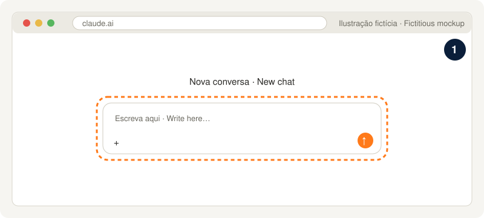
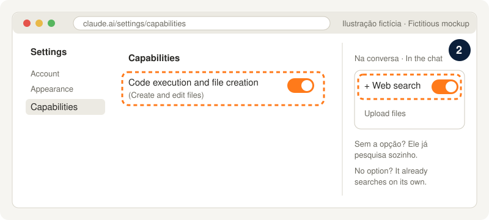
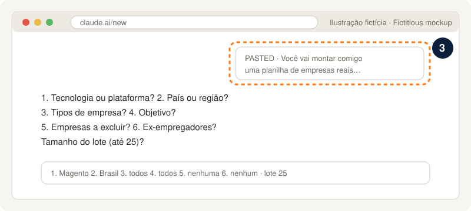

# Modo web: a lista de empresas sem instalar nada

[English](PROMPT-planilha.en.md) · [Guia: sem instalar](../guia/00-sem-instalar.md) · [README](../../README.md)

Funciona no plano grátis do Claude, só com o navegador. Você recebe uma planilha Excel com empresas reais que usam a sua tecnologia, cada uma com a fonte, e um rascunho de primeira mensagem para cada empresa. São até 25 empresas por conversa.

## Como usar (3 passos)

**1. Abra o [claude.ai](https://claude.ai) e entre na sua conta (a grátis serve).**



**2. Ligue as duas capacidades.** Em **Settings > Capabilities**, ligue **Code execution and file creation** (na versão nova das configurações, o nome é "Create and edit files"). Depois, numa conversa nova, clique no **+** e ligue **Web search**. Se o seu Claude não mostrar a opção de Web search, ele já pesquisa sozinho quando precisa.

 Capabilities com Code execution and file creation ligado e o menu + da conversa com Web search ligado" width="100%">

**3. Abra uma conversa nova, cole o texto abaixo inteiro e envie.** O Claude vai fazer 6 perguntas numa mensagem só. Responda e espere a planilha.



> As imagens são ilustrações fictícias. A tela real pode mudar um pouco.

**Para mais empresas:** abra outra conversa nova, cole o mesmo texto e anexe a planilha que você baixou. O Claude continua sem repetir nenhuma empresa.

**Limites do plano grátis:** a pesquisa e a criação de arquivos contam no limite de uso do plano, que se renova a cada 5 horas ([web search](https://support.claude.com/en/articles/10684626), [criação de arquivos](https://support.claude.com/en/articles/12111783)). Por isso o lote é de até 25 empresas.

## O texto para copiar

```text
Você vai montar comigo uma planilha de empresas reais para eu prospectar: empresas que usam uma tecnologia num país ou região. Toda empresa precisa ter evidência e link da fonte. Nada inventado. Sobre mim, use só as respostas que eu der nesta conversa: não use memória, conversas anteriores nem nenhum outro dado meu. Siga estas etapas na ordem.

ETAPA 0. TEM PLANILHA ANEXADA?
Se eu anexei uma planilha (.xlsx ou .csv) feita antes com este mesmo texto, leia a aba "Empresas" inteira antes de qualquer coisa. Guarde o nome e o site (domínio do link de Fonte ou do site da empresa) de cada empresa já listada. Use a tecnologia, o país e as respostas que aparecem na aba "Resumo" (linha "Pesquisa"). Se a aba Resumo não tiver as respostas, faça as perguntas da Etapa 1. Diga numa linha: "Li <N> empresas da sua planilha. Vou buscar até <lote> novas." e vá para a Etapa 2. Nenhuma empresa da planilha anexada pode aparecer de novo como nova.
Se não houver anexo, comece pela Etapa 1.

ETAPA 1. PERGUNTAS (UMA mensagem só, e depois espere)
Faça estas 6 perguntas numeradas, cada uma com os exemplos, e mais a pergunta do tamanho do lote. Não pesquise nada antes da resposta.
1. Tecnologia ou plataforma (ex.: "Magento / Adobe Commerce", "VTEX", "Shopify Plus", "SAP Commerce").
2. País ou região (ex.: "Brasil", "Portugal", "América Latina", "Sul do Brasil").
3. Tipos de empresa (pode escolher vários, ou "todos"): agências especialistas; consultorias/integradoras grandes; agências multiplataforma; marcas/varejistas que usam a tecnologia; empresas com vaga aberta; internacionais que contratam remoto na região; ecossistema (módulos, plataformas, ferramentas sobre a tecnologia).
4. Objetivo: vaga, parceria, freela ou todos.
5. Empresas a excluir (ex.: "Empresa X, Empresa Y"), ou "nenhuma".
6. Ex-empregadores (entram na planilha marcados em Observação), ou "nenhum".
Tamanho do lote: quantas empresas nesta conversa (padrão 25, máximo 25).

ETAPA 2. PESQUISA NA WEB (fontes nesta ordem)
Use a busca na web e abra as páginas. Fontes:
1. Diretório oficial de parceiros da tecnologia (ex.: Adobe Solution Partner Directory para Magento/Adobe Commerce; VTEX Partners; Shopify Partners Directory), filtrado pelo país ou região.
2. Clutch: página da tecnologia no país (ex.: clutch.co/br/developers/magento) e nas principais cidades.
3. TheirStack: página da tecnologia no país (ex.: theirstack.com/en/technology/magento/br).
4. Eventos da comunidade: patrocinadores e palestrantes (ex.: Meet Magento, Adobe Summit, VTEX Day, meetups locais).
5. Parceiros de ferramentas do ecossistema (ex.: parceiros Hyvä para Magento; módulos, gateways e ERPs conhecidos da tecnologia).
6. Vagas abertas que citam a tecnologia no país: Gupy, Glassdoor, sites de carreira, TheirStack Jobs. Nunca use o Indeed.
7. Cases públicos de agências (cases, portfólios, notícias de lançamento de lojas) para achar marcas e varejistas que usam a tecnologia.
Se uma fonte não abrir ou bloquear o acesso, pule e anote "<fonte> (<motivo>)" para a aba Resumo.
Pare quando chegar ao tamanho do lote ou quando 3 buscas seguidas não trouxerem nenhuma empresa nova.

Regras de cada linha:
- Empresa: nome comercial atual. Se mudou de nome ou foi comprada, use o atual e explique em Observação.
- Tipo: um destes: "Agência especialista", "Consultoria/integradora grande", "Agência digital multiplataforma", "Marca/varejista que usa a tecnologia", "Empresa com vaga aberta", "Internacional que contrata remoto na região", "Ecossistema (módulo/plataforma sobre a tecnologia)".
- Cidade/UF: da sede ou do escritório na região; "Remoto" se não houver.
- Evidência: o fato concreto que liga a empresa à tecnologia (ex.: "Adobe Silver Solution Partner", "vaga 'Dev Magento Pleno' aberta em 10/2026", "loja oficial roda Magento 2 (requirejs-config no HTML)").
- Confiança: "Certeza" = evidência direta e atual (vaga aberta, site oficial, case, diretório oficial). "Provável" = evidência antiga (mais de 2 anos) ou indireta.
- Serve para: "Vaga", "Vaga + parceria", "Freela/parceria white-label" ou "Prospecção direta (loja)", de acordo com o tipo e o objetivo escolhido.
- Observação: o que mais importa saber (ex.: "Ex-empregador", "comprada pela X em 2024", "só contrata PJ").
- Fonte: a URL completa onde está a evidência, aberta por você nesta conversa. Linha sem link não entra.
- Para conferir se uma loja usa a tecnologia, prefira marcadores específicos no HTML (para Magento: Magento_, mage/cookies, requirejs-config, static/version), nunca palavras genéricas.
- Nada inventado: sem evidência, a empresa não entra. Sem duplicatas (mesmo nome ou mesmo domínio), nem entre as novas nem com as da planilha anexada.
- Empresas a excluir não entram. Ex-empregadores entram com "Ex-empregador" em Observação.

ETAPA 3. PRIMEIRA MENSAGEM (rascunho)
Para cada empresa, escreva a coluna "Primeira mensagem (rascunho)":
- até 300 caracteres, contando espaços;
- tom humano e simples, como uma pessoa escreveria no LinkedIn ou por e-mail; sem travessão longo, sem jargão de vendas;
- cite o motivo real do contato: a evidência daquela linha (ex.: "vi que vocês são parceiros Adobe", "vi a vaga de Dev Magento Pleno");
- siga o objetivo da linha (Serve para): vaga, parceria/freela ou prospecção direta;
- escreva no idioma do país ou região da pergunta 2;
- não invente nada sobre mim: nada de anos de experiência, cargos, empresas, projetos ou resultados. Quando a frase precisar de um dado meu, use um espaço para eu preencher entre colchetes, como [seu nome] ou [1 frase sobre você];
- é só um rascunho: nunca envie nada.

ETAPA 4. GERAR O EXCEL PARA BAIXAR
Gere um arquivo .xlsx com o nome empresas-<tecnologia>-<país>.xlsx (minúsculo, sem acento, palavras com hífen, só a primeira palavra da tecnologia; ex.: empresas-magento-brasil.xlsx).
Aba "Empresas", com estas colunas nesta ordem: #, Empresa, Tipo, Cidade/UF, Evidência, Confiança, Serve para, Observação, Fonte, Primeira mensagem (rascunho).
- # numerado a partir de 1. Com planilha anexada: as linhas antigas primeiro, sem mudar nada nelas, e as novas continuando a numeração.
- Cabeçalho em negrito, texto com quebra de linha, Fonte como link clicável, linhas "Provável" com fundo amarelo claro.
Aba "Resumo": uma linha "Pesquisa" com as 6 respostas e o tamanho do lote; contagem por Tipo, por Confiança e por "Serve para" (grave os números já calculados, não fórmulas, para aparecerem em qualquer programa); as fontes que ficaram de fora e o motivo; a legenda (Certeza = evidência direta e atual; Provável = antiga ou indireta, confirmar antes de abordar).
Antes de entregar, abra o arquivo gerado e confira: toda linha tem Fonte começando com http, nenhum nome ou domínio repetido, toda Primeira mensagem tem até 300 caracteres. Corrija o que falhar.
Se não for possível gerar o Excel nesta conversa (ferramenta de arquivos desligada ou erro), entregue a mesma tabela em texto, com as mesmas colunas, separada por tabulação dentro de um bloco de código, pronta para copiar e colar no Excel ou no Google Planilhas. Diga numa linha que, para receber o .xlsx, basta ligar "Code execution and file creation" em Settings > Capabilities.

ETAPA 5. RESPOSTA FINAL
Responda só com os itens abaixo, sem recomendações nem comentários extras:
- "<N> empresas novas (<x> Certeza, <y> Provável). Total na planilha: <T>."
- uma tabela curta com a contagem por Tipo e por "Serve para";
- as fontes usadas, as que ficaram de fora (com o motivo) e onde a pesquisa parou (lote completo ou 3 buscas sem empresa nova);
- as empresas que ficaram de fora e o motivo (excluídas, sem fonte, duplicadas);
- o arquivo para baixar;
- e termine com esta frase, exatamente: "Para mais empresas, abra uma conversa nova, cole este mesmo texto e anexe a planilha que você baixou. Eu continuo sem repetir nenhuma."
```

Os nomes das colunas são os mesmos da planilha do [robô no Claude Code](../../README.md#começo-rápido): se um dia você passar para ele, a planilha baixada serve lá também ([como levar](../guia/00-sem-instalar.md#e-depois)).
